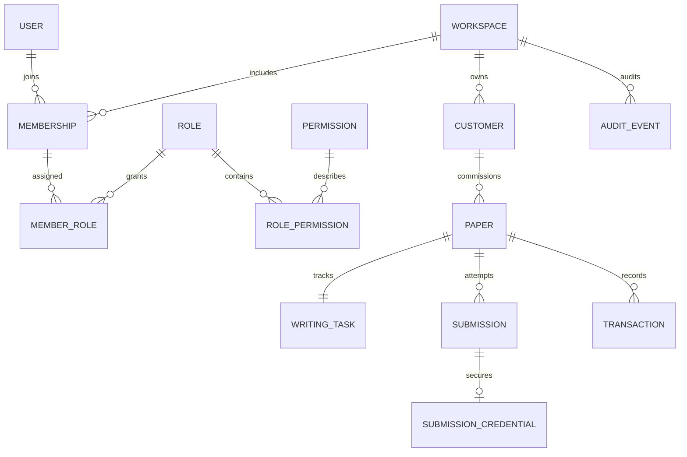

# 多人上线准备设计

本文是团队协作版本的实施依据。当前代码支持加密文件和 MySQL 两种存储，已支持多账号注册和独立工作空间，未启用团队共享、角色分工、多空间切换或成员管理。部署仍通过本机监听配合 HTTPS 反向代理，账号隔离不代表已经实现团队授权。

## 当前已准备的结构

- 客户、论文、每次投稿、收支流水分别拥有独立 UUID。客户通过 `paper.customerId` 关联；投稿和流水属于论文，不通过客户姓名或论文题目关联。
- 写作题目属于论文；每次投稿保留独立的投稿题目和期刊，修改写作题目不会改变既往投稿题目。
- 每个可编辑实体保存版本号与创建、修改时间；接口检查版本号，冲突返回 409。
- `BusinessStore` 是业务存储边界；由加密文件 `Vault` 或关联表 `MysqlStore` 实现。当前仍是整份业务状态的事务接口，MySQL 通过空间行锁、可重复读及按实体变更写入保证一致性，业务列分别入表，没有将整份状态存入单一 JSON 字段。数据读取仍会装载当前空间的全部状态；后续多人和大数据量版本须继续拆分为按实体查询和分页的 Repository。
- `schema=2` 维护客户及多次投稿数据；旧版文件登录时迁移并保留上一份加密副本，旧版备份恢复时也会迁移。
- 敏感密码只有显式的凭据接口返回，客户汇总、论文列表和各模块 CSV 不输出密码。这些接口是将来细分权限的执行点。
- MySQL 初始化脚本已有空间、用户、成员、角色、权限、客户、论文、写作任务、投稿、凭据、当前投稿指向、收支及历史表；关联外键约束空间一致性。每个注册账号关联自己的工作空间和管理员角色，会话绑定账号及空间；其他预设角色没有可用的业务授权流程。
- MySQL 模式已拆分身份密码哈希与投稿凭据密钥，并提供旧加密文件的事务导入和可跨模式恢复的加密备份。备份数据库必须连同独立密钥一起保存。

## 目标数据关系

当前已实现 MySQL；若后续采用 PostgreSQL，可继续沿用关系设计。业务实体采用 UUID 主键，费用用 `BIGINT` 整数分（CNY），业务日期用 `DATE`；当前 MySQL 时间列用 UTC `DATETIME(6)`，PostgreSQL 可用 `TIMESTAMPTZ`。不要用浮点数存费用，也不要用姓名或题目做外键。下表是多人目标模型，实际已实现字段以 `db/mysql/` 脚本为准；安全审计和财务冲正尚未实现。

| 表 | 关键字段 / 外键 | 约束与用途 |
|---|---|---|
| workspace | id、name、owner_user_id | 每个团队或独立经营者一个工作空间 |
| app_user | id、normalized_username、password_hash、status | 独立身份；账号唯一；密码哈希，不可逆保存 |
| workspace_member | id、workspace_id、user_id、status | 同一用户可加入多个空间；二元唯一约束 |
| role / permission | id、code；permission.resource/action | 角色与细粒度权限分离 |
| member_role / role_permission | membership_id/role_id、role_id/permission_id | 多对多；角色授权有审计 |
| customer | id、workspace_id、name、phone、email、cooperation_started_at、owner_member_id、version | 允许同名，以身份编号区分；合作开始日期可为空；联系信息按权限展示 |
| paper | id、workspace_id、customer_id、title、authors、contract_cents、owner_member_id、version | 客户归属必须属于同一空间 |
| writing_task | id、workspace_id、paper_id、writer_member_id、external_writer_name、status、start_at、due_at、delivered_at、fee_cents、deposit_cents、version | 当前一篇一条，paper_id 唯一；后续若支持多写作人再单独扩展分配表 |
| submission | id、workspace_id、paper_id、title、journal_name、system_name、url、status、submitted_at、ended_at、published_at、assigned_member_id、version | 一篇可多次投稿；发表成果来自对应投稿记录 |
| submission_credential | id、workspace_id、submission_id、account、password_ciphertext、key_id、email、phone | 与投稿一对一；密文与展示资料分开查询；凭据访问单独授权与审计 |
| financial_transaction | id、workspace_id、paper_id、writing_task_id、type、amount_cents、occurred_at、method、note、created_by、version | 写作支出可关联写作任务；收入与论文服务合同对应；关联字段仍须空间一致 |
| business_history | id、workspace_id、paper_id、submission_id、action、actor_member_id、occurred_at、snapshot | 投稿业务历史，不保存密码；与安全审计分开 |
| audit_event | id、workspace_id、actor_user_id、permission、resource_type/id、result、occurred_at | 记录授权变更、密码查看、导出、删除、恢复及登录事件；日志不记录密钥、密码和会话令牌 |

外键建议使用 `(workspace_id, parent_id)` 复合外键，并在父表提供对应唯一索引，防止跨空间关联。只做 `id` 外键不能完整防止跨空间写入。客户被关联时禁止硬删除，可归档；数据库版财务流水应使用冲正/作废，而非直接删除。当前本机版允许删除错误流水，上线前需要实现审计和冲正流程。

必备索引：`(workspace_id, updated_at)`、`paper(workspace_id, customer_id)`、`submission(workspace_id, paper_id, submitted_at)`、`writing_task(workspace_id, writer_member_id/status/due_at)`、`financial_transaction(workspace_id, paper_id, occurred_at)`。按实际查询分别建立写作人的索引与状态、交期索引，不照抄表达式为一个 SQL 索引。投稿时长以日期计算，避免持久化每天变化的统计值。客户费用先按论文聚合流水，再聚合客户，不能直接把论文与多次投稿、流水连接后求和，否则会产生重复金额。

## 预设角色及访问范围

角色名称和分配可在正式上线前按实际人员调整；下表作为默认方案。当前不创建这些账号或开通权限。

| 角色 | 业务范围 | 金额与客户资料 | 投稿密码 | 管理权限 |
|---|---|---|---|---|
| 空间管理员 | 本空间全部业务 | 查看、维护、导出 | 可显式查看，记录审计 | 本空间成员、角色、备份和恢复 |
| 业务主管 | 本空间业务、任务分配 | 查看及维护客户和论文费用 | 需单独授予凭据查看权限 | 不管理空间所有权和授权 |
| 写作人员 | 分配给自己的写作任务与对应文章 | 仅本人稿酬；客户资料最小化展示 | 无 | 无 |
| 投稿专员 | 分配给自己的投稿和必要论文信息 | 默认无合同费用、客户联系方式及写作者成本 | 仅获授权的投稿，显式操作可查看 | 无 |
| 财务人员 | 本空间合同和收付款 | 可看费用、登记、冲正、导出；联系人按职责授权 | 无 | 无 |
| 只读人员 | 明确授权的业务范围 | 默认隐藏敏感联系信息和成本 | 无 | 无；导出单独授权 |

后续如开放客户登录，单独增加“客户门户账号 → customer_id”关联，只能查看自己的论文公开状态与应收款，不能凭客户角色访问内部稿酬、投稿账号或其他客户。客户资料和系统用户必须分表，客户无需天然拥有登录账号。

## 权限检查边界

建议权限码：`customer.read/write`、`paper.read/write`、`writing.read/write/assign`、`submission.read/write/assign`、`credential.reveal`、`finance.read/write/reverse`、`export.customer/paper/writing/submission/finance`、`backup.download/restore`、`member.manage`、`role.manage`。

每个服务请求建立不可由客户端伪造的 `ActorContext(userId, workspaceId, membershipId, permissions, scope)`：

1. 会话认证和成员状态检查；空间身份取自已验证会话，而不是只相信请求体中的 workspace_id。
2. 资源动作权限检查；默认拒绝。隐藏页面按钮不等于接口授权。
3. Repository 查询同时包含 workspace_id 和数据范围（全部 / 负责 / 分配给本人 / 自己创建）。使用 UUID 也必须检查数据归属。
4. 字段权限检查：客户电话邮箱、合同收入、写作者成本和密码分别控制；字段过滤在后端执行。
5. 新建或改关联前验证所有外键属于同一空间；批量查询、导出、统计、备份也必须执行同样的范围限制。

当前接口按单人会话校验并默认允许该本机用户的全部业务操作；没有上述细分权限，不应向其他用户宣称已有角色隔离。

## 身份和密钥迁移

当前文件模式用管理密码派生整库加密密钥；MySQL 模式已经使用 PBKDF2 登录密码哈希及独立本机密钥文件加密投稿密码，管理密码用于加密可移植业务备份。正式多人模式还需接入服务器密钥管理服务、支持 key_id 轮换，并提供独立的备份授权与密钥策略。不要将现有管理员密码写入配置、SQL、迁移脚本或默认账号。

上线前需实现 HTTPS、服务端会话存储/撤销、登录失败限流、管理员重置及恢复流程、审计、CSRF 与来源保护、后端字段权限、数据范围过滤和并发事务。管理员退出、被停用或角色变更后，其会话授权须及时失效。

## 实施顺序及验收

1. 已实现原文件副本保留及保留 UUID 的 MySQL 事务导入，记录源文件哈希。正式多人迁移还需补迁移批次、数据量及金额校验报告，不在现有文件上试运行数据库脚本。
2. 当前已创建固定空间及首个管理员，旧的自由文本写作人继续保留。多人版本需支持真实空间和业务负责人的管理，并可将写作人映射为成员。
3. 以 Repository 替换整状态 BusinessStore 的数据获取，补分页、索引与事务；本机加密数据继续保留为回滚来源。
4. 实现权限服务、ActorContext、成员/角色管理及接口审计，覆盖所有读写、详情、凭据、导出与恢复端点。
5. 用至少两个空间和多种角色验证：同空间分配范围、跨空间猜测 ID、直接接口调用、统计/导出越权、密码访问、批量操作及角色撤销。
6. 对比迁移前后的客户论文数、已发表期刊、定金/尾款分类合计与未收未付；测试旧备份导入、并发编辑冲突、财务冲正和回滚。

以上验收通过后才提供多人公网版本；数据库选型和角色细节可以在实际部署前确认，不影响当前业务模块开发。
